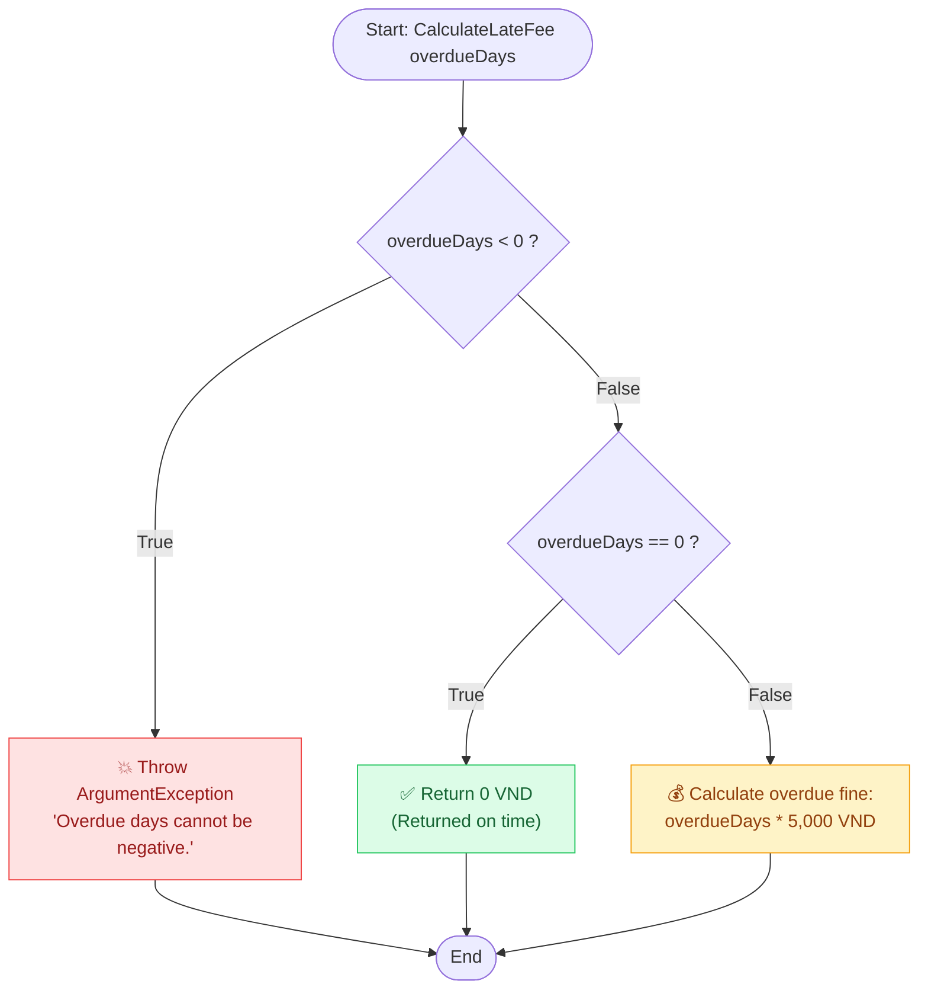
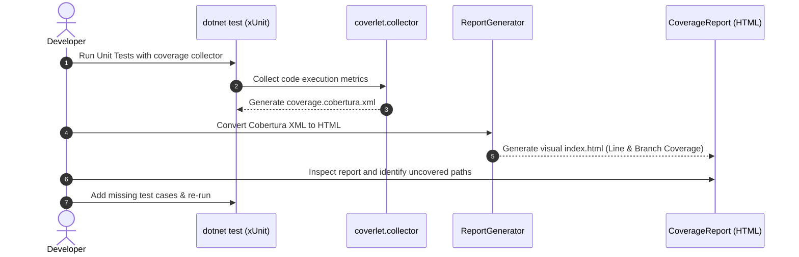

# 📚 LibraryManagement & .NET Code Coverage Demo

> **Demo project illustrating Unit Testing, Code Coverage, and HTML Reporting in .NET.**

---

## 💡 Overview / Quick Summary (English)

> **Does "All Tests Passed" mean your entire codebase has been thoroughly tested?**
>
> **The answer is No.**
>
> Imagine you just finished a new feature in a .NET application. You run your entire test suite and see:
> ```text
> Passed: 120 | Failed: 0
> ```
> Every test passed. However, an entirely new method might not have been touched by any test, or a critical business branch might never have been executed. Without coverage metrics, it's impossible to know which lines and execution paths were actually verified.
>
> **Test Results vs. Code Coverage:**
> - **Test Results (Passed/Failed):** Verify whether your test assertions passed.
> - **Code Coverage:** Pinpoints which lines and branches of code were actually executed during test runs.
>
> ⚠️ **Key Takeaway:** High code coverage does not guarantee bug-free software; it merely highlights blind spots and gaps in your test suite. Proper assertions and edge-case testing are what truly ensure system reliability.

---

## 🎯 Project Introduction

This project demonstrates a real-world scenario: **a library overdue fine calculation system**.

### Business Rules
1. **On-time return (`overdueDays == 0`)**: No fine charged (`0 VND`).
2. **Overdue return (`overdueDays > 0`)**: Fine charged = `overdueDays * 5,000 VND`.
3. **Negative overdue days (`overdueDays < 0`)**: Invalid input, throws an `ArgumentException`.

---

## 🔄 Execution Flowcharts & Diagrams

The following Mermaid flowchart illustrates the decision branches in [`CalculateLateFee`](file:///d:/Practices/Test/LibraryManagement/LibraryManagement/LibraryService.cs#L7-L21):



### Coverage Workflow: From Initial Test to Comprehensive Testing



---

## 📁 Project Structure

```text
LibraryManagement/
├── LibraryManagement.slnx                      # Solution file
├── LibraryManagement/
│   ├── LibraryManagement.csproj               # Class library project
│   └── LibraryService.cs                      # Overdue fine business logic
├── LibraryManagement.Tests/
│   ├── LibraryManagement.Tests.csproj         # xUnit test project
│   ├── LibraryServiceTests.cs                 # Unit tests (AAA pattern)
│   └── TestResults/                           # Test execution results & Cobertura XML
└── CoverageReport/                            # HTML report folder generated by ReportGenerator
    └── index.html
```

---

## 🚀 Getting Started & CLI Commands

### 1. Prerequisites & Tool Installation

- **Install `coverlet.collector`** (for collecting test coverage):
  ```bash
  dotnet add LibraryManagement.Tests/LibraryManagement.Tests.csproj package coverlet.collector
  ```

- **Install ReportGenerator CLI** (global tool for generating visual HTML reports):
  ```bash
  dotnet tool install --global dotnet-reportgenerator-globaltool
  ```

---

### 2. Run Tests & Collect Code Coverage

Collect coverage data in Cobertura XML format (`coverage.cobertura.xml`):

```bash
dotnet test LibraryManagement.Tests/LibraryManagement.Tests.csproj --collect:"XPlat Code Coverage"
```

---

### 3. Generate HTML Coverage Report via ReportGenerator

Convert the Cobertura XML output into an interactive HTML dashboard:

```bash
reportgenerator "-reports:LibraryManagement.Tests/TestResults/**/coverage.cobertura.xml" "-targetdir:CoverageReport" "-reporttypes:Html"
```

Once completed, open [`CoverageReport/index.html`](file:///d:/Practices/Test/LibraryManagement/CoverageReport/index.html) in your browser to inspect line coverage, branch coverage, and uncover untested logic paths.

---

## 🧪 Unit Tests Overview

The test suite adheres to the standard **AAA (Arrange - Act - Assert)** pattern:

- [`CalculateLateFee_WhenReturnedOnTime_ReturnsZero`](file:///d:/Practices/Test/LibraryManagement/LibraryManagement.Tests/LibraryServiceTests.cs#L6-L13): Verifies that returning on time (`0` days) charges `0 VND`.
- [`CalculateLateFee_WhenOverdue_ReturnsExpectedFee`](file:///d:/Practices/Test/LibraryManagement/LibraryManagement.Tests/LibraryServiceTests.cs#L16-L23): Verifies that `3` overdue days calculates to `15,000 VND`.
- [`CalculateLateFee_WhenDaysAreNegative_ThrowsException`](file:///d:/Practices/Test/LibraryManagement/LibraryManagement.Tests/LibraryServiceTests.cs#L26-L32): Verifies that negative values (`-1` days) throw an `ArgumentException`.
